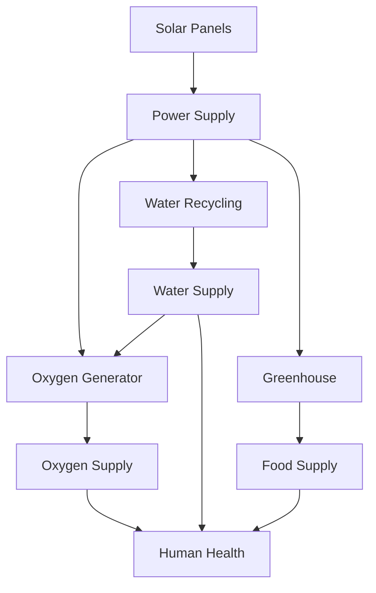
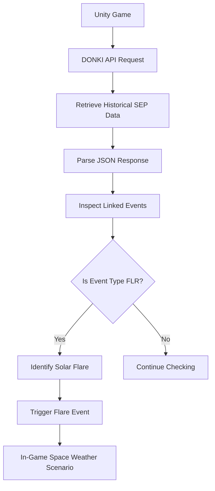
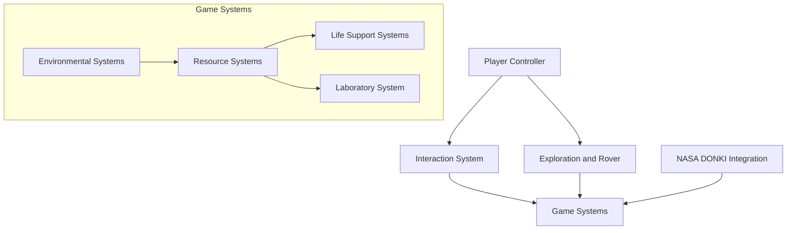

# 🔴 RED FRONTIER
### Mars Outpost Survival Simulator | NASA Space Apps Challenge 2026

> **Beyond Earth, Beyond Imagination.**


Red Frontier is an interactive Mars outpost survival simulator developed for NASA Space Apps Challenge 2026 under the challenge **"Build a Junior Astronaut Mission Trainer."**

The project puts players in charge of a Martian outpost where survival depends on managing limited resources, maintaining life-support systems, exploring the Martian surface, conducting laboratory experiments, and responding to space-weather threats.

Rather than simply teaching students about space exploration through textbooks, Red Frontier allows them to experience the decisions, consequences, and engineering trade-offs involved in sustaining human life on Mars.

---

## 🚀 Project Overview

| Information | Details |
|---|---|
| Project Name | Red Frontier |
| Team | Team Platinum |
| Competition | NASA Space Apps Challenge 2026 |
| Challenge | Build a Junior Astronaut Mission Trainer |
| Project Type | Interactive Simulation / Educational Game |
| Platform | PC (Windows) |
| Game Engine | Unity |
| Programming Language | C# |
| NASA Data Source | NASA/CCMC DONKI |
| Primary Dataset | Solar Energetic Particle (SEP) |
| Environment | Mars Outpost |

## 🎯 The Problem We're Addressing

Establishing a human settlement on Mars is not simply a matter of transporting astronauts to another planet.

A functioning Martian outpost must continuously maintain essential resources, including oxygen, water, food, and electricity. These systems are interconnected, meaning a shortage in one resource can create a chain reaction affecting the entire settlement.

For example:

- Oxygen production requires water and electricity.
  

- Water recycling requires electricity.
 
  

- Greenhouse food production requires electricity.
  

- Astronaut health depends on the availability of oxygen, water, and food.
  

- Solar energy provides electricity but can be affected by environmental conditions.
  


Understanding these relationships requires more than memorizing scientific concepts. Students need opportunities to experiment, make decisions, and experience their consequences.

**Red Frontier aims to bridge this gap through an interactive Mars survival experience.**

---

## 🪐 What Can Players Do?

Red Frontier is built around several interconnected gameplay activities.

### 1. Outpost Resource Management

Players are responsible for maintaining the essential resources required to keep their Martian settlement operational.

The primary resources include:

| Resource | Purpose |
|---|---|
| Oxygen | Supports astronaut survival and life-support operations |
| Water | Essential for astronauts and oxygen production |
| Food | Maintains astronaut health |
| Power | Operates life-support systems and other infrastructure |
| Health | Represents the overall condition of the astronaut |

Players must monitor resource availability and manage the systems responsible for producing and consuming them.


A resource surplus in one area does not necessarily mean the outpost is safe. Poor management of another resource can still threaten the mission.

### 2. Interconnected Life-Support Systems

The simulation uses resource dependencies to demonstrate how a Martian habitat operates as an interconnected system.

The basic dependency structure is:



Players must understand that operating one system can affect the availability of resources elsewhere.

For example, increasing oxygen production may improve oxygen availability but also increase water and power consumption.

This creates meaningful resource-management decisions rather than allowing players to maintain every system without consequences.

### 3. Martian Surface Exploration

Survival on Mars requires more than managing resources inside a habitat.

Players can leave the outpost and explore the surrounding Martian environment.

During exploration, players can:

- Travel outside the habitat.
  

- Collect Martian surface material (regolith).
  

- Explore areas beyond the main outpost.
  

- Return to the habitat to replenish their spacesuit oxygen.
  


Exploration introduces another layer of resource management because astronauts must consider their available suit oxygen before leaving the safety of the habitat.

### 4. Scientific Laboratory Simulation

Red Frontier includes a simulated laboratory where players can investigate collected Martian surface samples.

The gameplay process follows three basic steps:

1. **Collect:** Leave the habitat and gather Martian regolith.
2. **Analyze:** Bring the collected sample into the laboratory.
3. **Discover:** Run a simulated laboratory analysis and receive results.

This feature introduces students to the idea of planetary science and scientific investigation.

Instead of treating Martian soil as an ordinary environmental object, players can interact with it as a scientific sample.

**Note:** Laboratory outputs are simulated gameplay results, not actual chemical measurements of Martian soil.

### 5. Rover Exploration

A rover provides an additional way to travel across the Martian environment.

Players can enter the rover, travel across the terrain, and return to controlling their astronaut.

The rover extends the exploration experience beyond the immediate surroundings of the habitat.

### 6. Environmental and Space-Weather Events


Mars presents environmental challenges that can threaten the safety and sustainability of an outpost.

Red Frontier incorporates a NASA DONKI-powered historical space-weather scenario to introduce solar activity into the simulation.

The intention is to demonstrate how external space-weather events can become operational challenges for astronauts living beyond Earth.

---

## ☀️ NASA DONKI API Integration


One of the important technical components of Red Frontier is its integration with NASA's Community Coordinated Modeling Center (CCMC) DONKI database.


### What is DONKI?

DONKI stands for:

**Database of Notifications, Knowledge, Information.**

It is a NASA/CCMC space-weather database that provides information about solar and interplanetary events, including:

- Solar Flares (FLR)
- Solar Energetic Particles (SEP)
- Coronal Mass Ejections (CME)
- Geomagnetic Storms (GST)
- Interplanetary Shocks (IPS)

Official resources:

- [NASA/CCMC DONKI](https://ccmc.gsfc.nasa.gov/DONKI/)
- [DONKI API Documentation](https://ccmc.gsfc.nasa.gov/DONKI/api/)
- [CCMC Public APIs](https://ccmc.gsfc.nasa.gov/tools/API/)

### Why Are We Using DONKI?

Solar activity can create hazardous radiation environments for astronauts outside Earth's protective magnetic field.

For a Martian settlement, space-weather awareness is an important part of mission planning and astronaut safety.

We use DONKI data to introduce actual historical solar activity into our simulated Martian environment.

### Dataset Used

**Solar Energetic Particle (SEP) Dataset**

The SEP dataset provides information about solar energetic particle events.

These events can be associated with other solar activities, including solar flares and coronal mass ejections.

Red Frontier retrieves SEP event information and examines its linked-event records to identify associated solar flare events.

### How the Integration Works

The integration follows a straightforward process:



**Step 1 — API Request**

Unity sends an HTTP request to the CCMC DONKI API to retrieve historical SEP event information for a selected date range.

**Step 2 — Retrieve SEP Information**

The API returns structured JSON data containing information about the identified solar energetic particle events.

**Step 3 — Parse the Response**

The application processes the returned JSON response and extracts relevant information, including event identifiers, instruments, and linked events.

**Step 4 — Identify Linked Solar Flares**

DONKI provides relationships between different space-weather events through its linked-event information.

Red Frontier examines the linked event activity IDs and identifies events associated with the `FLR` event type.

**Step 5 — Trigger the In-Game Event**

When a linked solar flare is identified, the application can trigger the corresponding solar-flare gameplay scenario.

This separates NASA data retrieval and event identification from the actual gameplay event logic.

### Why Historical Data Instead of Live Events?


Solar energetic particle events and major solar activity do not occur on a predictable schedule suitable for a short educational gameplay session.

Relying exclusively on newly occurring events could make it difficult for students to experience a solar-weather scenario during gameplay.

To address this, Red Frontier uses a selected historical event window from January 2024.

The simulation retrieves real historical NASA DONKI data associated with that period, allowing the same space-weather scenario to be reproduced consistently.

This approach provides:

- A repeatable gameplay scenario.
- Real historical space-weather information.
- Reliable testing and demonstration.
- An opportunity for students to experience a space-weather event without waiting for a new solar event.

**Important:** Red Frontier does not claim to provide real-time solar-flare monitoring or live radiation forecasting. The current implementation uses historical NASA DONKI information to drive a reproducible simulation scenario.

---

## 🏗️ System Architecture

Red Frontier is developed using a modular Unity component-based architecture.

The project uses individual gameplay and resource-system components attached to Unity GameObjects. Systems communicate through component references and direct method calls where appropriate.

The objective is to keep the implementation understandable, maintainable, and expandable without introducing unnecessary architectural complexity.

### Architectural Overview



### 1. Player Layer

Responsible for player movement, interaction, and gameplay state.

Core responsibilities:

- Player movement and camera control.
- Interaction with nearby objects.
- Entering and exiting vehicles.
- Switching between indoor and outdoor gameplay states.
- Managing spacesuit oxygen behavior.

The player logic is separated from individual environmental and resource systems.

### 2. Interaction Layer

Provides a common interaction mechanism for interacting with objects in the environment.

The interaction system uses raycasting and interactable components to identify and communicate with objects.

This allows different objects to implement their own interaction behavior without requiring the player controller to know the internal implementation of every object.

### 3. Resource and Life-Support Layer

Individual systems manage their respective resources and production or consumption behavior.

Examples include:

- Oxygen System
- Water System
- Food System
- Power System
- Health System
- Heating System

Each system is responsible for its own resource-related calculations.

Resource changes generally follow this principle:

`Resource Change = Production - Consumption`

Systems use configurable values to determine how much of a resource is produced or consumed over a given interval.

### 4. Exploration Layer

Responsible for outdoor gameplay, rover interaction, and spacesuit resource behavior.

The player's indoor and outdoor states affect how oxygen is consumed.

When outside, the astronaut relies on the spacesuit oxygen supply. When returning inside, the spacesuit oxygen can be replenished through the habitat.

### 5. External Data Layer

The DONKI integration is separated from the gameplay systems.

Its responsibilities include:

- Sending API requests.
- Retrieving historical SEP data.
- Parsing the returned JSON.
- Identifying linked solar flare events.
- Notifying the gameplay layer when a qualifying event is identified.

This separation helps prevent API communication logic from becoming tightly coupled with the resource-management implementation.

---

## 🎮 Player Controls

The following table describes the intended default control layout. Verify the actual bindings in the project's Unity Input Actions asset before publishing a final build.

| Input | Action |
|---|---|
| W | Move Forward |
| A | Move Left |
| S | Move Backward |
| D | Move Right |
| Mouse | Look Around |
| Left Shift | Sprint |
| Space | Jump |
| Mouse left Click | Interact |
| Mouse Right Click | Exit Rover |

**Interaction:** Look toward an interactable object and use the interaction key to activate it.

**Rover:** Enter the rover through its interaction point and use the movement controls to drive. Use Escape to exit.

---

## 🧪 Simulation Mechanics

### Resource Consumption and Production

Resource systems operate through configurable production and consumption values.

For example, the food system can periodically consume power while producing food through greenhouse operations.

The system uses adjustable parameters such as:

- Production rate.
- Power consumption.
- Maximum resource capacity.
- Update interval.
- Production efficiency.

These parameters allow gameplay balancing without requiring changes to the underlying system logic.

### Resource Dependencies

The simulation uses resource dependencies to create meaningful trade-offs.

For example:

| System | Requires | Produces / Supports |
|---|---|---|
| Solar Panels | Solar energy | Power |
| Oxygen Generator | Water + Power | Oxygen |
| Water Recycler | Power | Recycled Water |
| Greenhouse | Power | Food |
| Life Support | Oxygen + Water + Food | Astronaut survival |

The actual balance of these systems is controlled through configurable gameplay values.

### Indoor and Outdoor Survival

The astronaut has different survival requirements depending on their location.

- Outside the habitat, the spacesuit provides oxygen.
- Inside the habitat, the astronaut relies on the base life-support system.
- Returning to the habitat allows the spacesuit oxygen supply to be replenished.

This creates a connection between exploration and resource management.

---

## 🛠️ Technologies Used

| Technology | Purpose |
|---|---|
| Unity | Game development and simulation environment |
| C# | Gameplay programming and system logic |
| Unity Physics | Player movement, collision, and interaction |
| Raycasting | Object interaction |
| TextMeshPro | Resource meters and interface text |
| HTTP Requests | External NASA data retrieval |
| JSON | Processing DONKI API responses |
| NASA/CCMC DONKI | Historical space-weather information |
| Git & GitHub | Version control and project collaboration |

---

## 💻 Installation and Setup

### Requirements

- Windows PC.
- Unity Hub.
- Unity Editor version compatible with the project.
- Git.
- Internet connection for NASA DONKI API requests.

### Clone the Repository

```bash
git clone <(https://github.com/VioletShadow777-oss/NASA_Space_App_2026.git)>
```

Navigate to the project directory:

```bash
cd Red-Frontier
```

### Open the Project

1. Open Unity Hub.
2. Select **Add Project from Disk**.
3. Select the cloned Red Frontier project directory.
4. Open the project using its compatible Unity Editor version.
5. Open the main gameplay scene.
6. Press Play to start the simulation.

### NASA DONKI Connection

The DONKI integration requires internet access to retrieve historical event data.

If the API request fails, the external-data-dependent scenario may not be triggered.

Check the Unity Console for request and parsing errors when testing the integration.

---

## 📡 API Integration Considerations

The DONKI integration depends on an external service, so the following conditions should be considered:

- Internet connectivity is required.
- API responses may occasionally be delayed or unavailable.
- JSON parsing must account for missing or empty event information.
- Linked-event records may not always contain a solar flare.
- API failures should not be confused with failures in the core resource-management simulation.

The historical date selection makes the demonstration more repeatable, but it does not eliminate external API availability issues.

For production deployment, a cached historical response or controlled fallback scenario would improve reliability.

---

## 🎓 Educational Impact

Red Frontier aims to make space exploration more accessible through interactive learning.

It introduces students to several important concepts:

**Systems Thinking**

Understand how oxygen, water, food, power, and health depend on one another.

**Resource Management**

Learn why limited resources must be carefully distributed and maintained.

**Planetary Science**

Explore Martian terrain and investigate collected regolith samples through a simulated laboratory.

**Space Weather Awareness**

Discover how solar activity can create challenges for astronauts and space missions.

**Engineering Decision-Making**

Experience how changing one system can affect the performance of an entire outpost.

The broader goal is to encourage students to think beyond memorizing scientific concepts and begin approaching problems like engineers, researchers, and future space explorers.

---

## 🔭 Future Development

Red Frontier is an evolving prototype. The following areas represent potential future improvements:

- Expanded Martian exploration missions.
- More detailed laboratory experiments and scientific sample analysis.
- Additional environmental hazards and survival scenarios.
- More advanced radiation protection and habitat shielding mechanics.
- Expanded rover functionality.
- Improved resource management and automated system controls.
- More NASA space-weather datasets and historical scenarios.
- Additional educational missions and difficulty levels.
- Improved simulation feedback and learning objectives.

These are development directions rather than claims that every feature is already implemented.

---

## ⚠️ Current Limitations

Red Frontier is an educational simulation prototype, not a scientifically validated Mars habitat engineering model.

Some important limitations include:

1. **Historical Space Weather:** The current DONKI integration uses a selected historical event window rather than continuously monitoring live solar activity.

2. **External API Dependency:** NASA DONKI data retrieval depends on the availability of the external API and an active internet connection.

These limitations provide opportunities for future research and development.

---

## 📚 NASA Data Sources and References

The project uses NASA's publicly accessible space-weather information through the Community Coordinated Modeling Center.

| Resource | Usage |
|---|---|
| [NASA/CCMC DONKI](https://ccmc.gsfc.nasa.gov/DONKI/) | Historical space-weather information |
| [DONKI API Documentation](https://ccmc.gsfc.nasa.gov/DONKI/api/) | API integration reference |
| [CCMC Public APIs](https://ccmc.gsfc.nasa.gov/tools/API/) | NASA/CCMC API information |
| [NASA Space Apps Challenge 2026](https://www.spaceappschallenge.org/2026/) | Competition information |
| [Junior Astronaut Mission Trainer](https://www.spaceappschallenge.org/2026/challenges/junior-astronaut-mission-trainer/) | Official challenge statement |

### Data Attribution

Space-weather information used in Red Frontier is retrieved from NASA's Community Coordinated Modeling Center (CCMC) DONKI database.

The project uses historical Solar Energetic Particle event information and associated linked-event records to identify solar flare events.

The use of NASA data does not imply NASA endorsement of Red Frontier.

---

## 👥 Team Platinum

**Project:** Red Frontier  
**Competition:** NASA Space Apps Challenge 2026  
**Challenge:** Build a Junior Astronaut Mission Trainer

| Team Member | Contribution |
|---|---|
| [Irfan Rahman Iram] | Team Lead, Game Development, Simulation Systems and Integration |
| [Tasmia Siddique] | 3D Artist |
| [Asir Hamim] | Data Scientist |
| K.M. Shakil Ahmed Reyad | Problem Solver |
| K.M. Ashiqur Rahman Sayem | Researcher |


---

## 🎨 Third-Party Assets and Acknowledgements

We acknowledge the creators and providers of the third-party assets, tools, and resources used during development.

| Resource | Attribution |
|---|---|
| Unity | Game development engine |
| NASA/CCMC | DONKI space-weather database |
|(https://assetstore.unity.com/packages/3d/environments/chemistry-lab-items-pack-220212 | 3D models and environment assets |
https://assetstore.unity.com/packages/tools/animation/dotween-hotween-v2-27676 | 3D models and environment assets |
https://assetstore.unity.com/packages/3d/environments/sci-fi/free-low-poly-sci-fi-hangar-environment-demo-cosmic-retro-361516 | 3D models and environment assets |
https://assetstore.unity.com/packages/3d/environments/sci-fi/free-low-poly-sci-fi-laboratory-2-environment-demo-cosmic-retro-378678 | 3D models and environment assets |
https://assetstore.unity.com/packages/3d/environments/sci-fi/free-low-poly-sci-fi-laboratory-environment-demo-cosmic-retro-346024 | 3D models and environment assets |
https://assetstore.unity.com/packages/3d/environments/sci-fi/free-low-poly-sci-fi-reactor-environment-demo-cosmic-retro-422176 | 3D models and environment assets |
https://assetstore.unity.com/packages/2d/textures-materials/gridbox-prototype-materials-129127 | 3D models and environment assets |
https://assetstore.unity.com/packages/3d/environments/low-poly-office-props-lite-131438 | 3D models and environment assets |
https://assetstore.unity.com/packages/3d/vehicles/low-poly-sci-fi-modular-vehicle-demo-376098 | 3D models and environment assets |
https://assetstore.unity.com/packages/3d/props/electronics/low-poly-sci-fi-monitor-pack-2-sets-retro-crt-slimline-assets-326721 | 3D models and environment assets |
https://assetstore.unity.com/packages/3d/props/low-poly-sci-fi-rts-pack-359910 | 3D models and environment assets |
https://assetstore.unity.com/packages/3d/props/low-poly-industrial-pack-397642 | 3D models and environment assets |
https://assetstore.unity.com/packages/3d/environments/landscapes/mars-landscape-3d-175814 | 3D models and environment assets |
https://assetstore.unity.com/packages/3d/props/pks-laptop-low-264665 | 3D models and environment assets |
https://assetstore.unity.com/packages/3d/environments/sci-fi/real-stars-skybox-lite-116333 | 3D models and environment assets |
https://assetstore.unity.com/packages/3d/props/sci-fi-battery-barrel-packs-285735 | 3D models and environment assets |
https://assetstore.unity.com/packages/3d/environments/sci-fi/sci-fi-interior-modular-kit-demo-327705 | 3D models and environment assets |
https://assetstore.unity.com/packages/3d/vehicles/land/simple-drift-tyres-212232 | 3D models and environment assets |
https://assetstore.unity.com/packages/2d/gui/violet-themed-ui-235559)] | 3D models and environment assets |

| Chatgpt and Claude | Development assistance |

Individual asset licenses and attribution requirements should be respected according to their respective providers.

---

## 📄 Disclaimer

Red Frontier is an independent educational project developed for the NASA Space Apps Challenge 2026.

It is not an official NASA product, and it is not affiliated with or endorsed by NASA.

NASA/CCMC DONKI information is used for educational and simulation purposes. Historical space-weather records are not presented as real-time forecasts or operational radiation measurements for Mars.

The resource-management and laboratory systems are simplified representations designed to communicate scientific and engineering concepts through interactive gameplay.

---

## 🌍 Our Vision

Humanity's journey to Mars will require scientists, engineers, explorers, and problem-solvers who understand the challenges of living beyond Earth.

We believe that preparation for that future can begin in the classroom.

With Red Frontier, we want students to move beyond simply learning about Mars and begin experiencing the decisions that could one day define a real mission.

**Red Frontier — Beyond Earth, Beyond Imagination.**
